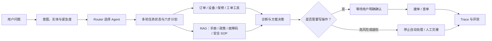

# ResolveFlow AI

ResolveFlow AI 是一个面向复杂售后服务的“决策与工单协同 Agent”。消费电子是第一个演示垂类，项目能力不绑定任何真实品牌。

项目不只生成客服回复，而是推进一个售后任务：识别意图、选择角色、核验订单与设备、检索企业知识、执行安全诊断、生成方案，并在用户确认后创建演示工单。遇到高风险或权限边界时，系统停止自动处理并转人工。

## 为什么需要 Agent

售后问题的信息往往不完整，处理路径会因设备、保修、安全风险和工具结果而变化。因此系统需要在多轮对话中维护任务状态，根据实时结果决定下一步，并在失败时局部重规划或安全停止。这是它区别于“大模型 + 固定工作流”的核心。

## 架构与业务链路



四类 Agent 角色：

- `intake`：接待、澄清信息和建立任务计划；
- `diagnostic`：设备故障诊断和安全分级；
- `resolution`：保修核验、方案决策与工单执行；
- `escalation`：高风险、权限不足和人工交接。

## 一键启动完整演示环境

前置条件：Docker Desktop 正在运行，并已在 `后端/.env` 中配置可用的 DeepSeek Key。不要把 `.env` 提交到仓库。

```bash
cd "ResolveFlow-AI/后端"
docker compose up -d --build
docker compose ps
```

启动后可直接访问：

| 入口 | 地址 | 用途 |
| --- | --- | --- |
| 用户演示页 | `http://localhost/` | 对话、知识库、评测和运行详情 |
| API 文档 | `http://localhost/docs` | Swagger 接口测试 |
| 健康检查 | `http://localhost/health` | 验证 API 与 Agent 初始化 |
| API 直连 | `http://localhost:8000` | 开发调试 |
| Prometheus | `http://localhost:9090` | 监控指标 |

若 Docker Hub 暂时无法拉取 Node 构建镜像，可先在本机验证前端，再用交付镜像启动：

```bash
cd "ResolveFlow-AI/前端"
npm ci
npm test
npm run build

cd "../后端"
docker compose -f docker-compose.yml -f docker-compose.runtime.yml up -d --build
```

## 开发模式

```bash
cd "ResolveFlow-AI/前端"
npm ci
npm run dev
```

开发预览为 `http://localhost:5173`，请求会代理到本地 Python API。

## 推荐演示脚本

### 主链路：三轮换货建单

1. 首轮输入：`RF202610270001`、`FBP-CN-A10001`、`FlowBuds Pro 左耳无声`、`E101`，并表达换货意图；
2. 第二轮说明低风险步骤已完成但仍无声，请求准备工单；
3. 第三轮明确回复“确认创建工单”；
4. 打开“运行详情”，讲解六步计划、已核验事实、知识依据、工具轨迹和待确认状态。

### 安全分支

点击“高风险升级”，演示电池鼓包与烧焦味如何触发安全停止和人工交接。对外用户只看到安全处置建议，路由、风险级别和交接信息只在“运行详情”中展示。

### 渐进式澄清与产品指标

输入“我耳机坏了”，页面会依次展示安全单选、故障多选和型号填写，每轮只问一组问题。问题组支持返回上一问和结束流程；返回操作会同步回滚后端状态，而不只是改变页面。

评测中心同时展示两类结果：

- Agent 质量：意图准确率、回复 Judge 分数和调用链通过率；
- 产品漏斗：澄清完成率、平均轮次、放弃率、退出点和人工升级率。

## 演示数据与边界

- 订单、设备、保修和工单来自本地模拟业务系统；
- 知识库、意图识别、多 Agent 路由、工具执行、Redis 状态、Trace 和评测为真实运行；
- 未接入真实 OMS、CRM、保修平台、物流、支付和人工坐席队列；
- 系统不会把“在保”直接等同于“必然免费换新”；
- 未经用户明确确认，不会执行创建工单等写操作。

## 验证结果

```bash
cd "ResolveFlow-AI/后端"
docker compose run --rm --no-deps -u root -v "$PWD:/app" api \
  sh -lc 'pip install -q -r requirements-dev.txt && python -m pytest -q'

cd "../前端"
npm test
npm run build
```

2026-11-01 实测：

- 后端 243 项自动化测试通过；
- 前端 26 项测试通过，Vite 生产构建成功；
- Docker 中 6 个服务全部健康，页面、API、Swagger 和统一网关均返回 200；
- 评测集 v1.3 包含 60 条意图样本（10 类）和 14 个对话场景（21 轮），新增路由、工具顺序/参数、状态和问题组断言；
- 真实 E101 用例按 `lookup_device → lookup_fault_code → run_device_diagnostic` 执行，参数与状态正确；
- v1.3 完整评测任务 `5c1cb6921ed54fbd86af054d003ae15e`：22/22 条有效结果通过，调用链 20/20 轮通过，评测错误 0；
- Judge 均值：相关性 1.0000、准确性 0.9643、完整性 0.8429、有用性 0.9333。

上述 100% 是这套版本化开发集的通过结果，不代表真实业务稳定 100% 或用户满意度 100%。评测方法、数据口径和复现边界见 [`docs/evaluation.md`](docs/evaluation.md)。

### 独立 holdout 结果

冻结开发集后，另建 `resolveflow-aftersales-holdout-v1.0`：100 条平衡意图样本、15 个对话场景、22 轮，不参与此前 Prompt 和规则调参。首次完整运行结果为：

- 意图准确率 88/100，95% 置信区间 80.19%–93.00%；
- 结果记录 12/23 通过，调用链 12/21 通过；
- Judge 均值：相关性 0.8318、准确性 0.9000、完整性 0.5977、有用性 0.6773；
- 评测执行错误 0。

该结果保留了真实泛化差距，不能与开发集 100% 合并。v1 holdout 从首次运行后转为回归证据；修复暴露问题后需要建立新的 v2 独立集。完整记录见 [`docs/evaluation.md`](docs/evaluation.md)。

### Holdout 暴露问题后的 P0 修复

首次 holdout 后没有修改标签或放宽断言，而是按失败类别修复通用规则：

- E201、E301 等故障码在设备身份完整时可进入真实诊断链路，不再只对 E101 生效；
- “蓝牙耳塞”不会被误识别为“蓝牙连接故障”，充电失败等口语表达可正确进入症状门控；
- “排查都完成了但仍未解决”可继承任务进度；“确认提交这张工单”与“算了，不要提交”分别执行确认和拒绝；
- 维修、换机、配件、工单进度、质量投诉等售后边界增加确定性规则。

修复后已通过 243 项后端回归，并用真实 API 复核 E201/E301 诊断、确认建单和拒绝建单链路。由于 v1 holdout 已被用于定位问题，不能把修复后的同集结果继续称为盲测；下一次对外更新泛化指标前需建立全新的 v2 独立集。

产品选题、Agent 必要性、人机边界和指标设计见 [`docs/product-decisions.md`](docs/product-decisions.md)。
